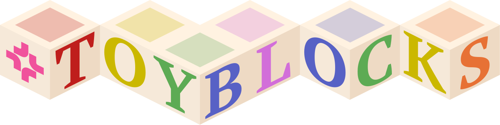

<p align="center">
  
</p>

# ToyBlocks

<h3 align="center">
  <a href="https://allenai.org/blog/toyblocks">Blog post</a> &nbsp;|&nbsp;
  <a href="https://allenai.github.io/ToyBlocks/docs/user_guide/index.html">Docs</a> &nbsp;|&nbsp;
  <a href="https://console.cloud.google.com/storage/browser/toyblocks-data">Data</a> &nbsp;|&nbsp;
  <a href="https://huggingface.co/collections/allenai/toyblocks">Models</a> &nbsp;|&nbsp;
  Tech report (coming soon)
</h3>

This repo contains ToyBlocks: an open simulation framework based on IsaacSim/IsaacLab, built around 
a robot arm manipulating blocks on a tabletop. The setting is deliberately simple, but the robot 
must still reason about how the blocks interact and how to arrange them while pushing, flipping, 
and stacking.

ToyBlocks automatically and scalably generates demonstration data for policy training, without requiring 
time-consuming and expensive teleoperation. Researchers can easily vary these training experiences. 
For example, a team could generate more pushing or flipping demonstrations, then evaluate performance 
on tasks kept out of training.

The generated datasets are recorded in the LeRobot format and can be used directly to train VLAs 
or other policies. ToyBlocks ships with training infrastructure for [ManiFlow](https://maniflow-policy.github.io/), a low-level visuomotor 
policy conditioned on language and on a target heatmap, and serves it either on its own or under a 
high-level policy (such as [Molmo2](https://allenai.org/blog/molmo2), Astra, Claude) that decides what to do next. 

Policies are evaluated in closed loop in simulation, either on freshly generated unseen scenes 
and tasks or on the exact initial states of episodes recorded in a dataset. Evaluation is GPU-parallel. 
Because every task's goal is expressed in PDDL, ToyBlocks automatically measures success and partial progress, 
with no task-specific metric code. Either level of a hierarchical policy can be replaced by an oracle 
to isolate where failures come from, and the states where a policy failed can be sent back to data generation 
to plan new expert demonstrations and recoveries from them.

The overall goal of ToyBlocks is to provide a controlled world for robot learning and evaluation. 
By providing full control over the data generation process, ToyBlocks provides tools for researchers 
to trace the outcomes of trained policies back to the training data.

## How to get started

The [docs](https://allenai.github.io/ToyBlocks/docs/user_guide/index.html) walk through each workflow:

- [Installation and Setup](https://allenai.github.io/ToyBlocks/docs/user_guide/workflows/installation_and_setup_instructions.html)
- [Automatic Data Generation](https://allenai.github.io/ToyBlocks/docs/user_guide/workflows/data_generation.html)
- [Training ManiFlow Policies on Automatically Generated Data](https://allenai.github.io/ToyBlocks/docs/user_guide/workflows/imitation_learning.html)
- [Policy Evaluation](https://allenai.github.io/ToyBlocks/docs/user_guide/workflows/evaluations.html)


## Quick start

This guide takes you from a fresh checkout of this repository to an evaluated policy on one simple,
contact-rich task: flipping the letter-M block forward, with a red block beside it on the table.
Along the way, you will generate a small dataset, train a policy on it, and evaluate that policy in
simulation.

Each step is the smallest useful version of a full workflow, so the whole guide runs quickly.
The documentation linked from each step covers the full-scale versions.

**Before you begin**, make sure your machine has one NVIDIA GPU (driver 570 or newer) and
[`uv`](https://docs.astral.sh/uv/getting-started/installation/) installed. See the
[installation guide](https://allenai.github.io/ToyBlocks/docs/user_guide/workflows/installation_and_setup_instructions.html)
for more details.

**Note:** this guide assumes that the `curobo`, `maniflow-tb` and
`molmo2` submodules are available to you. Step 1 fetches them with `git submodule update`. `curobo` and
`molmo2` are public, but `maniflow-tb` is currently internal to Ai2. The guide never
runs the Molmo2 model, but the `maniflow` install extra and the evaluation launcher both expect
the `molmo2` submodule to be present.

### Step 1: Install

First, install the data generation (`vecgen`), training (`maniflow`) and evaluation code into one
environment, and download the ToyBlocks assets. For more options, see the
[installation guide](https://allenai.github.io/ToyBlocks/docs/user_guide/workflows/installation_and_setup_instructions.html).

```bash
git clone https://github.com/allenai/ToyBlocks.git && cd ToyBlocks
uv venv --python 3.11 && source .venv/bin/activate
git submodule update --init --recursive
uv pip install -e ".[dev,isaac,torch-cu128,vecgen,maniflow]"
export OMNI_KIT_ACCEPT_EULA=YES
get-toyblocks-assets --asset-manifest asset_manifest.json
```

### Step 2: Generate data

Next, generate demonstrations for the task. The command below creates one problem, in which the
robot must flip the letter-M block (`block_m`) forward while a red block (`block_red`) sits on the
table as a distractor. To keep things simple, both blocks are 4 cm cubes, the table height is
fixed, and we use the default friction parameters. The pipeline then records two episodes of
the robot solving the problem and merges them into one dataset at
`data/datasets/merged/train/quickstart_flip`.

```bash
python scripts/datagen/run_datagen_pipeline.py --vecgen-record-videos \
    --experiment-id quickstart_flip \
    --task-gen-script "scripts/task_gen/flip.py --direction forward --target-block block_m --distractor-blocks block_red --distractor-count-min 1" \
    --task-gen-count 1 --num-distractors 1 \
    --block-size-range 0.04 0.04 --table-height-range 0 0 \
    --env-per-problem 2 --num-envs 2 --exec-num-envs 2 \
    --vecgen-problems-per-env 1
```

Once it finishes, check that the merged dataset contains both episodes. Only successful episodes
are kept, and the next step needs at least two, because training holds one back for validation.
If an episode failed, run the command again with a new `--experiment-id`, or ask for more
episodes by raising `--env-per-problem` together with `--num-envs` and `--exec-num-envs`.

**About rendering.** With `--vecgen-record-videos`, the cameras are recorded while the episodes
run, against the simulator's default background. This is the same scene the policy will see
during evaluation, so this guide skips the separate render stage. Full-scale data generation
instead renders every episode afterwards, following a flags YAML that describes how the scene is
drawn. To try it, replace `--vecgen-record-videos` with one `--render-pass` for each look you
want, and add `--rgb_224` to the training command in step 3 so that training uses the 224x224
videos the render writes:

```bash
# the RI training set's domain randomization: random backdrops, lighting and textures
--render-pass src/toyblocks/domain_randomization/flags/render_flags_allrand_texcache_glyphs_trainsplit_symmetric.yaml

# or one fixed look, with nothing sampled
--render-pass src/toyblocks/domain_randomization/flags/render_flags_plain.yaml

# or both: three randomized copies of every episode next to one plain copy
--render-pass src/toyblocks/domain_randomization/flags/render_flags_allrand_texcache_glyphs_trainsplit_symmetric.yaml:3 \
--render-pass src/toyblocks/domain_randomization/flags/render_flags_plain.yaml
```

The randomized backdrops come from two sets of images: the Poly Haven set, which step 1
installed, and the Laval indoor set, which is licensed separately. Without the Laval set, the
render logs a `skybox bucket resolved 0 textures` warning and uses Poly Haven alone.

To learn more, see
[Automatic Data Generation](https://allenai.github.io/ToyBlocks/docs/user_guide/workflows/data_generation.html)
and [Running the pipeline on this machine](https://allenai.github.io/ToyBlocks/docs/user_guide/workflows/datagen/local.html).

### Step 3: Train a policy

Now train a ManiFlow policy on the new dataset for 2000 steps on one GPU. On an NVIDIA GeForce
RTX 5090, this takes about 10 minutes. The `--val_ratio 0.5` option holds episode 0 back for
validation, so the policy learns from episode 1. Weights & Biases logging is turned off.

```bash
CUDA_VISIBLE_DEVICES=0 python maniflow-tb/scripts/train_maniflow.py \
    --data_root_dir data/datasets/merged/train/quickstart_flip \
    --run_id quickstart_flip --duration 2000 --save_interval 2000 --dbs 32 --val_ratio 0.5 \
    --wandb_mode disabled
```

When training finishes, the checkpoint is saved to
`runs/quickstart_flip/checkpoints/steps_2000_model.safetensors`.

**If training stops early** with an `IndexError` from the T5 tokenizer, the last batch of an
epoch was too small (1 to 3 samples). Look for the line
`[FrankaDataset] train: 1 episodes, N samples` in the log, and choose a batch size (`--dbs`) that
divides `N` exactly or leaves a remainder of at least 4. The value of `N` depends on how long the
recorded episode is, which can vary from one data generation run to the next, even with the
pipeline's fixed seeds. For details, see
[The last batch of an epoch](https://allenai.github.io/ToyBlocks/docs/user_guide/workflows/imitation_learning.html#the-last-batch-of-an-epoch).

To learn more, see
[Pre-training ManiFlow Policies](https://allenai.github.io/ToyBlocks/docs/user_guide/workflows/imitation_learning.html)
and the [`train_maniflow.py` reference](https://allenai.github.io/ToyBlocks/docs/user_guide/workflows/imitation_learning/train_maniflow.html).

### Step 4: Evaluate the policy

Finally, evaluate the policy on the episode it was trained on. A symbolic planner provides the
high-level commands (which block to act on, and how), so this evaluation measures the trained
low-level policy on its own.

```bash
python scripts/launch_eval.py --policy maniflow \
    --model-path runs/quickstart_flip/checkpoints/steps_2000_model.safetensors \
    --dataset-path data/datasets/merged/train/quickstart_flip --episode-indices 1 \
    --save-hl-overlay-video --no-save-sensor-obs-video
```

The results and a LeRobot recording of the rollout are saved under
`runs/quickstart_flip-v0/maniflow/`. Thanks to `--save-hl-overlay-video`, the recording includes
a video of the camera view with the high-level command drawn on top: the instruction and its
target point. `--no-save-sensor-obs-video` skips the separate per-episode camera videos
(`sensor_obs_videos/`). Weights & Biases logging stays off unless you add `--wandb`.

Perhaps the learned policy didn't quite solve the task, but it was a close one!

To learn more, see
[Policy Evaluation](https://allenai.github.io/ToyBlocks/docs/user_guide/workflows/evaluations.html)
and the [`launch_eval.py` reference](https://allenai.github.io/ToyBlocks/docs/user_guide/workflows/evals/launch_eval.html).

## Code Organization

All source code in `src/toyblocks/`

- `src/toyblocks/tasks`: all hand created tasks as well as templates for PDDL based task generation
- `src/toyblocks/vecgen`: the datagen engine (FF planning, batched skills, cuRobo planner pool, LeRobot recording)
- `src/toyblocks/robots`: all robot assets and configurations, including controllers
- `src/toyblocks/serving`: policy serving infrastructure (`BasePolicy`, `PolicyServer`, WebSocket client, obs transforms)
- `src/toyblocks/eval`: evaluation of learned models (with or without oracles) and replay
- `src/toyblocks/wrappers`: gym `Wrapper` subclasses (recording, stats, obs flattening)
- `src/toyblocks/cli`: command line utilities
- `src/toyblocks/data_annotation`: dataset annotation utilities
- `src/toyblocks/utils`: utilities for ToyBlocks
- `src/toyblocks/utils/rigid_objects`: utilities for working with rigid objects (e.g. creating them more easily)

The ManiFlow and Molmo2 policy code is in the `maniflow-tb/` and `molmo2/` submodules; the agentic
robotics loop (LLM agents with the skills as MCP tools) is the `agentic_robotics/` submodule, see
[Agentic Robotics](https://allenai.github.io/ToyBlocks/docs/user_guide/workflows/agentic_robotics.html).

## License

ToyBlocks is licensed under the [Apache License 2.0](LICENSE).
The `curobo`, `maniflow-tb`, `molmo2` and `agentic_robotics` submodules and the downloaded assets (e.g. the HDRI pools) are
distributed under their own licenses.
